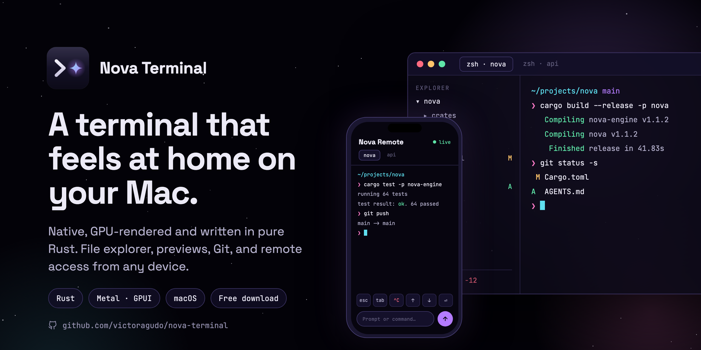
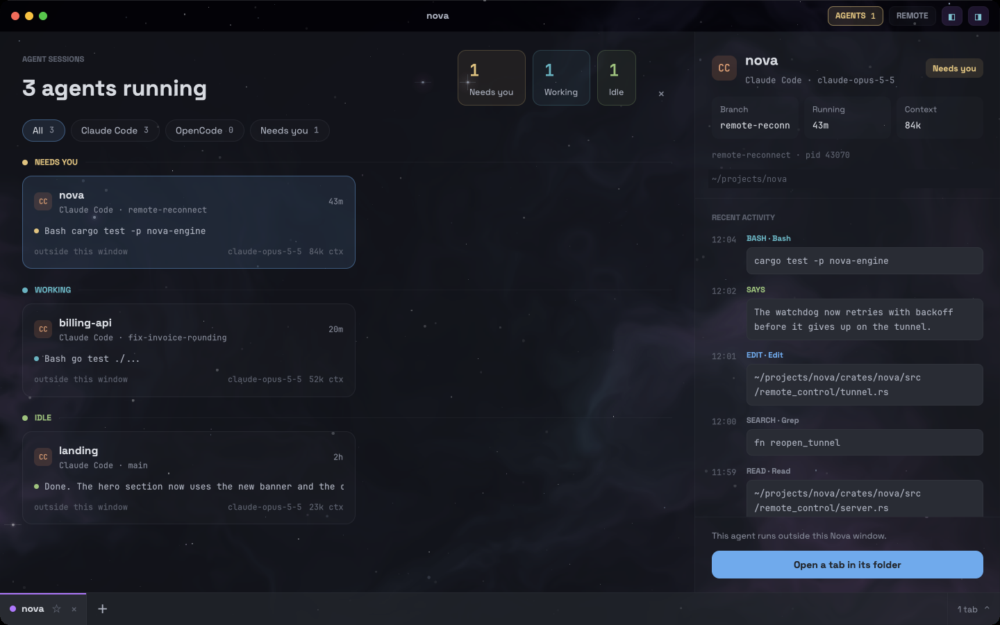
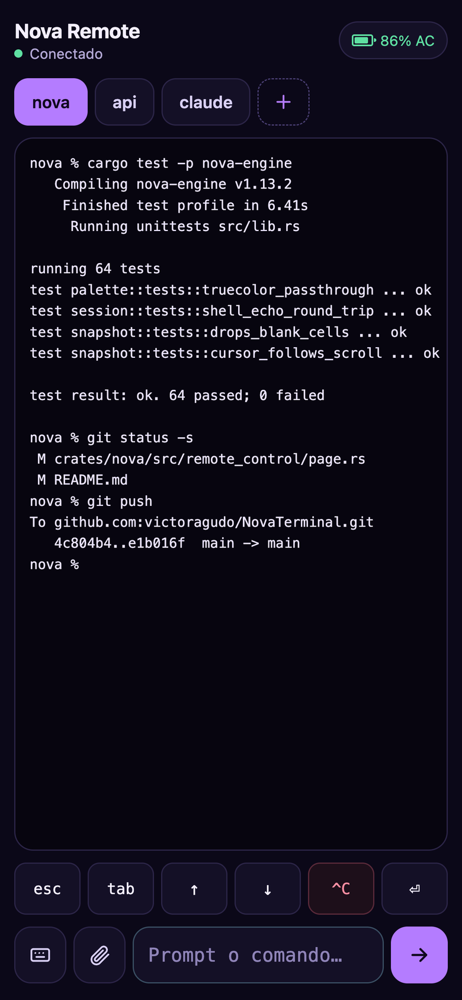
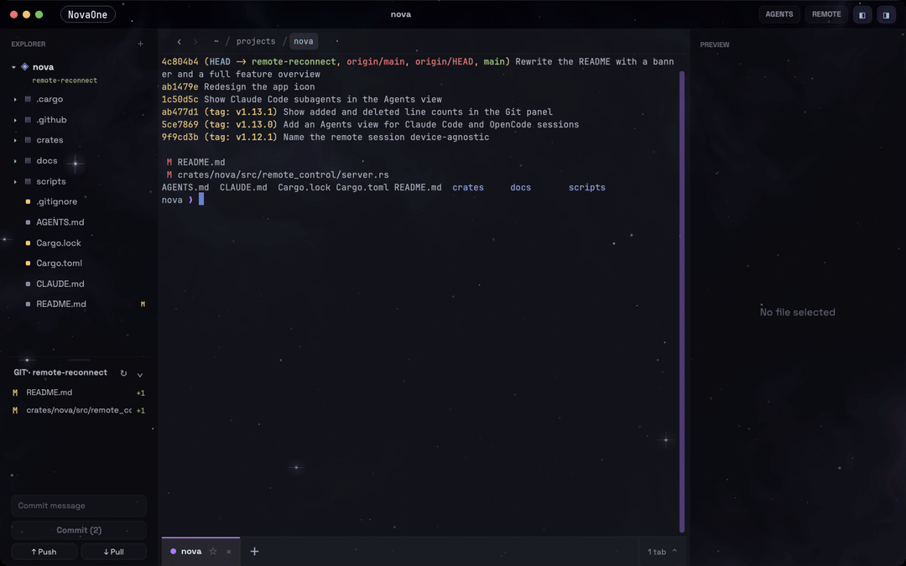

  

# Nova Terminal

Nova is a terminal for macOS. I wrote it in Rust because I wanted something fast that also looks nice, and that has the things I use every day (files, previews, Git, my AI agents) in the same window.

There is no Electron. The GPU draws the whole interface through Metal.

**Website:** [nova-terminal.pages.dev](https://nova-terminal.pages.dev)

## Install

1. Download the latest `.dmg` from [Releases](https://github.com/victoragudo/nova-terminal/releases/latest).
2. Open it and drag **Nova** into **Applications**.
3. Open Nova. That's it.

You need an Apple Silicon Mac with macOS 13 or newer. Every build is signed and notarized by Apple, and Nova updates itself with Sparkle.

## What it does

**Terminal**
- Every tab has its own shell. It starts as a login shell, so it loads the same profile as Terminal.app. You can pick a different shell in Settings (`Cmd+,`).
- Full colors (16, 256 and truecolor), scrollback, selection, search.
- The grid follows the window: resize it, or open the sidebar or the preview, and the terminal reflows to fit.
- Tabs come back when you open the app again. You can rename them, lock them so they ask before closing, and reorder them by dragging.
- Links work in TUIs too, even when they wrap across lines, and you can choose which Chrome profile opens them.
- When a tab in the background finishes its work, you get a macOS notification. Click it to jump to that tab.

**Split panes**
- Split the current tab right (`Cmd+D`) or down (`Cmd+Shift+D`). Each pane is its own shell, started in the folder you were in.
- Drag another tab onto the terminal to put it beside the current one, or drag a pane by its label to move it somewhere else in the split.
- Double-click a pane's label to give it its own name.
- `Cmd+Shift+G` arranges every pane in a grid, and `Cmd+Alt+=` gives every pane the same amount of space.
- Move between panes with `Cmd+[` and `Cmd+]`, or with `Cmd+Alt` and the arrow keys.
- Split layouts, pane names and locks come back when you relaunch.

**Command palette**
- `Cmd+K` opens a fuzzy search over every command, open tab, Claude session, theme and artifact.
- Start with a group name like `sessions:` or `tabs:` to search only that group.

**Workspace**
- A file tree on the side that follows your `cd`.
- Create, rename, copy, move and delete files without leaving the app.
- Previews for code (with syntax colors), images, SVG, PDF, zip files and hex. One click opens the native Quick Look.
- Back and forward history, like a browser.

**Git**
- Branch and status badges in the file tree.
- A small Git panel with added and deleted line counts, commit, pull and push.

**Agents**

If you run AI coding agents, you probably have a few of them going at once in different tabs. The Agents view (`Cmd+Shift+A`) shows all of them in one place.

- It finds every Claude Code and OpenCode session running on your Mac, including subagents and Claude Code profiles. You don't need to set anything up.
- Sessions are grouped into **Needs you**, **Working** and **Idle**, so you can see at a glance which agent is waiting for an answer.
- Click a session to see what it's doing: the project, branch, how long it has been running, how much context it uses, and its last steps (edits, commands, reads, searches, messages).
- If an agent is waiting on a permission prompt, Nova shows the question. You can **Approve** it or **Interrupt** the agent right there.
- **Go to tab** jumps to the agent's terminal. If it runs outside Nova, you can open a new tab in its folder instead.
- Hover an `[Image #1]` or `[Pasted text #2]` placeholder in the terminal to preview what the agent was sent. `Cmd+click` opens it.

  

**Claude sessions**
- `Cmd+Shift+O` lists every Claude Code session you ever ran, across all your Claude Code profiles, with full-text search.
- Open one to resume it in a new tab, in the folder it was started from.
- Rename sessions, or move the ones you don't need to the Trash.
- `Cmd+Y` shows the whole conversation, and `Cmd+G` jumps between the messages that match your search.

**Artifacts**
- `Cmd+Shift+E` shows the claude.ai Artifacts that Claude Code published from your sessions.
- `Cmd+Alt+E` opens the artifact beside the terminal. It also opens by itself when an agent in the current tab publishes one.

**Remote access**
- Open your real Nova windows and tabs from any device with a browser: your phone, a tablet or another computer. You see the live terminal and can type into it.
- The page fits the screen. On a phone you get big keys for Enter, Ctrl-C, Esc, Tab and the arrows. On a laptop or desktop it becomes a wide console.
- You can switch or close tabs, open new ones, upload files and scroll the whole history. Every split pane shows up as its own tab.
- Browse your Claude sessions from the phone and resume any of them in a new tab on the Mac.
- By default it goes through a temporary Cloudflare tunnel and keeps the Mac awake. If you prefer, it also works on your LAN or VPN (`NOVA_REMOTE_CLOUDFLARE=0`).
- If the tunnel dies or the app crashes, a watchdog brings it back and can send you the new URL on Telegram.

  

**Looks**
- An animated nebula background with stars and the odd shooting star.
- Ten themes: Nova Dark, Nova Light, Enana Blanca, Kilonova, Andromeda, Solar, Aurora, Púlsar, NovaOne and NovaOne Light. `Cmd+Shift+L` cycles through them.
- JetBrains Mono and Space Grotesk come inside the app.

  

## Keyboard shortcuts

| Action | Keys |
|--------|------|
| Command palette | `Cmd+K` |
| New tab / new window | `Cmd+T` / `Cmd+N` |
| Close pane or tab | `Cmd+W` |
| Split right / split down | `Cmd+D` / `Cmd+Shift+D` |
| Arrange panes in a grid | `Cmd+Shift+G` |
| Equalize pane sizes | `Cmd+Alt+=` |
| Next / previous pane | `Cmd+]` / `Cmd+[` |
| Next / previous tab | `Ctrl+Tab` / `Ctrl+Shift+Tab` |
| Toggle sidebar / preview | `Cmd+B` / `Cmd+Alt+B` |
| Agents | `Cmd+Shift+A` |
| Claude sessions | `Cmd+Shift+O` |
| Artifacts / artifact beside terminal | `Cmd+Shift+E` / `Cmd+Alt+E` |
| Remote session | `Cmd+Shift+R` |
| Next theme | `Cmd+Shift+L` |
| Settings | `Cmd+,` |

## Performance

I care a lot about this part, so here is what Nova actually does:

- **Paint never waits for the terminal.** Each frame takes a quick copy of the visible screen and releases the lock straight away. The shell keeps writing while the UI draws.
- **The background doesn't touch the UI.** The nebula lives in its own small view. The rest of the app is cached and only redraws when something really changes, like new output, typing or a resize.
- **The nebula runs on the GPU.** It's a Metal compute shader at half resolution, capped at about 30 fps. It only goes to 60 fps while a shooting star is on screen.
- **It sleeps when you're not looking.** When the window is not active, all the animation stops.
- **Slow work stays off the main thread.** Git status, previews and the current folder lookup run in the background.
- **Small binary.** The release build is about 12 MB (thin LTO, stripped), with fonts and images included.

## Stack

| Part | What |
|------|------|
| Language | Rust (stable) |
| UI | [GPUI](https://github.com/zed-industries/zed), Zed's UI framework on Metal |
| Terminal core | [`alacritty_terminal`](https://crates.io/crates/alacritty_terminal) |
| Background | Metal compute kernel (MSL built at runtime), with a CPU fallback |
| Previews | syntect, resvg, CoreGraphics for PDF, zip |
| Web content | Native `WKWebView`, only for the Artifacts view |
| Updates | [Sparkle](https://sparkle-project.org) |
| Remote | Small built-in web server, Cloudflare Tunnel, optional tmux mode |

The source code lives in a private repo. This one has the releases, the update feed and the issue tracker. The code is split into two crates:

- **`crates/nova-engine`**: the terminal core. One PTY, one terminal model and one I/O thread per tab. It has no UI code and only gives the UI owned data (`RenderSnapshot`, `EngineEvent`).
- **`crates/nova`**: the app itself. Window, tabs, split panes, file tree, previews, Git, themes, settings, Agents view, Claude sessions, Artifacts and the remote.

## Feedback and contributing

Found a bug or have an idea? Open an [issue](https://github.com/victoragudo/nova-terminal/issues/new/choose). I read all of them.

Pull requests to the README and docs are welcome too. See [CONTRIBUTING.md](CONTRIBUTING.md) for how it works.

## Known limits

- GPUI has no styled scrollbars, so Nova draws its own.
- The default remote needs Docker running.
- Apple Silicon only. There is no Intel build.

## License

MIT
